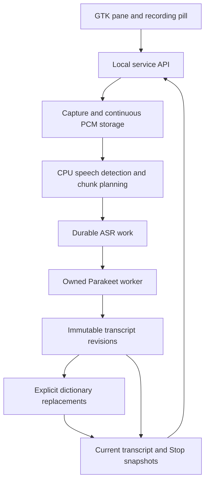

# Reliable long-form transcription

30 October 2026 — transcription-first interface, global replacements, capture pause/resume.

This is a personal dictation tool: start recording, think aloud for as long as
needed, occasionally glance at the transcript to check that the system is
following, and Stop with the audio saved and the text copied. Text arrives in
completed transcription groups; word-by-word previews are unnecessary.

The complete workflow remains in scope. Removing S1 changes the text-processing
step, not the recording, durability or desktop requirements. Output is Parakeet
ASR plus explicit, reversible dictionary replacements. There is no automatic LLM
rewriting and no replacement cleanup model planned.

## What stays and what is removed

| Keep | Purpose |
| --- | --- |
| Service-owned capture and continuous PCM storage | Recordings survive a closed or crashed GTK app. |
| CPU Silero detection and bounded ASR groups | Transcribe during recording without sending long silence or unbounded inputs to the GPU. |
| SQLite, immutable ASR revisions and publications | Recover interrupted work, fence stale results and preserve exactly what was copied. |
| Explicit dictionary and reversible edits | Correct known spellings without model guesses; retain Original text. |
| Transcription view, History tab and retry/reprocess | Check progress and recover from recognition or detection mistakes. |
| Existing ASR worker lifecycle | Lazy load, serial requests, idle unload and no orphan process after service death. |

Remove S1 weights/runtime preparation, the cleanup process and queue, model-edit
validation/diff machinery, GPU preemption/eviction coordination, cleanup controls,
status fields and model benchmarks. Keep CPU ggml from `vendor/llama.cpp` because
Silero still uses it; no llama-server or language model runs in this workflow.

One public service owns recording, persistence and the Parakeet worker. GTK
controls sessions and renders saved state. Audio writing has its own bounded
queue and thread; SQLite calls serialize through short transactions. A separate
storage executor, model registry or message broker is unnecessary.



The service remains responsive while the worker loads or transcribes. Use the
existing private worker endpoint, public service discovery and identity checks.
The worker exits after abrupt service death; a second service cannot take over
the same data directory before the previous worker is reaped. Never stop an
unrelated process discovered on a port.

This scope excludes remote exposure, other operating systems, speaker
identification, summaries, conversational assistance, automatic dictionary
learning, fuzzy spelling guesses and automatic deletion of saved audio.

## Durable audio and session storage

Use ordinary files for audio and one embedded SQLite database for session metadata, transcript revisions, pending work and edit decisions. The service is the sole writer. This gives related state changes real transactions instead of implementing a transaction protocol across several JSON files. No database server or ORM is needed.

Use a pinned SQLite amalgamation with its direct C API, foreign keys enabled and `journal_mode=WAL`, `synchronous=FULL`. Use one serialized connection, keep transactions short, and checkpoint the WAL without holding long-lived readers. The audio callback only queues samples; the dedicated writer performs storage calls. Verify the effective settings at startup. SQLite durability covers the database; audio files require their own synchronization. [SQLite durability settings](https://sqlite.org/pragma.html#pragma_synchronous), [WAL](https://sqlite.org/wal.html), [amalgamation](https://sqlite.org/amalgamation.html)

Storage layout:

```text
~/.local/share/paraketto/
  sessions.sqlite3
  sessions/<session-id>/audio/
    000000.pcm
    000001.pcm
    000002.pcm.part
  history/                       existing entries retained during migration
```

Audio storage blocks and ASR chunks are different concepts. Use 30-second storage blocks, rotate independently of speech boundaries, and record sample offsets at 16 kHz. Raw PCM avoids an unfinished WAV header making the active recording unreadable. Playback/export can serve bounded ranges as WAV; do not assemble an entire long recording in memory.

Durability policy:

1. Create the session record and its audio directory before acknowledging recording start. Synchronize newly created directory entries and their parent directories so the session path survives a power failure.
2. Copy microphone buffers into a bounded queue. The audio callback performs no inference or database work.
3. A writer appends audio and synchronizes it at least once per second under normal disk conditions. Synchronize the audio directory after creating each new block, before its first durable checkpoint. Publish the durable sample position only after the file and its directory entry are durable and the corresponding database commit succeeds.
4. On rotation and Stop, synchronize the file, rename the completed block and synchronize the containing directory before committing its finalized metadata.
5. On queue overflow, write failure or disk exhaustion, stop capture visibly and preserve everything already saved. Never silently discard buffers while reporting uninterrupted recording.

The one-second checkpoint interval is a target for the unsynchronized tail, not a guarantee of zero loss after power failure. Fault tests must measure it and distinguish captured, written and durable sample positions. Save complete frames recoverable from an interrupted `.part` file, and record any gap rather than pretending capture continued through a restart.

Track GStreamer timestamps and discontinuity indications alongside sample counts so device-side dropouts are visible even when disk writes succeed.

Keep silence in the saved source audio; skip it when assembling inference input. At this format an hour is about 115 MB. This preserves quiet speech that VAD might misclassify and permits retranscription. Physical silence compaction can be evaluated later without changing the original timeline or the transcription format.

Logical records in the database:

| Record | Essential contents |
| --- | --- |
| Session | ID, source, start/stop times, capture state, transcription state, settings snapshot and failure reason. |
| Audio block | Session, sequence, path, source sample range, durable frame count and finalized state. |
| ASR segment | Ordered source audio spans, segment sequence, pending/running/completed/failed state, attempts and active transcript revision. |
| Processing generation | Session, segmentation/configuration revision, planned-through sample position, final source endpoint and dispositions for speech, skipped silence and capture gaps. |
| Transcript revision | Immutable raw text, text hash, audio references, ASR model/configuration revision and inference measurements. |
| Dictionary revision | Immutable canonical terms, aliases, matching rules and revision hash. |
| Edit and decision | Original span, before/after text, dictionary rule/revision, enabled state and decision revision. |
| Publication | Immutable text snapshot, source/edit revision references, completion state and publication ID. |

Pending work comes from these records; do not add a separate message broker. A unique job identity includes its input revision and relevant configuration. Inference can run again after a crash, but committing its result must be idempotent. Reject late results for superseded revisions or deleted sessions.

Advance planning coverage transactionally with the segment jobs and silence/gap dispositions it creates, never beyond durable audio. Recovery must replay unplanned audio from a defined safe boundary with sufficient VAD context, including an unfinished speech group that had not yet produced a job. At Stop or interruption, seal the final audio endpoint. Transcription is complete only when planning covers that endpoint and every required ASR segment has completed successfully; an empty queue alone does not establish completeness.

Keep transcript revisions local to stable ASR segments. A session or publication references an ordered set of segment revisions; adding speech does not replace the entire transcript or invalidate earlier edits. Audio writing has its own bounded queue and must not wait behind history rendering, VAD or model loading. Waveform samples remain transient; the database records durable progress and decisions.

## Speech detection and transcription during recording

Move capture into the user service so closing or restarting GTK does not discard an active recording. Preserve GStreamer capture and the existing waveform measurements. Start with one active local microphone session; repeated start requests with the same request ID return that session, while a different concurrent start receives a clear conflict.

Reuse the Jarvis Silero v5 CPU implementation, carry its attribution and pin its weights. Compare its frame probabilities and state resets against its reference fixtures when adapting ggml. The detector estimates speech activity; it does not know whether a thought or sentence is complete.

Use hysteresis and padding to avoid cutting weak syllables. These defaults are validated against checked recordings, not a guarantee of perfect detection:

| Parameter | Policy |
| --- | --- |
| VAD processing | Stateful 512-sample frames at 16 kHz; process every frame in order. |
| Detection thresholds | Onset 0.15, continuation 0.10; detector-only gain toward RMS 0.01, limited to 16×. Saved audio and ASR input remain unchanged. |
| Speech padding | Retain approximately 300 ms before and 500 ms after detected speech. Merge overlapping padded spans. |
| Long silence | After about 2 seconds of sustained non-speech, finalize the current speech group and omit the silent interior from ASR input. |
| ASR grouping | Prefer natural pauses around 30–60 seconds of retained audio; short speech followed by long silence is submitted without waiting for a minimum duration. |
| Maximum ASR input | 90 seconds, below the existing 120-second single-pass boundary. Use the quietest recent boundary when continuous speech reaches the cap. |
| Uncertain detection | Retain uncertain regions. If VAD is unavailable, use bounded time/energy chunks and mark silence filtering unavailable. |

Several short speech spans may be assembled into one ordered ASR input to retain context, with each span's original sample range recorded. Do not insert artificial word boundaries into the text merely because audio contains a pause. Flush pending speech at Stop, including speech shorter than the normal grouping target.

Use non-overlapping ASR chunks, matching the existing long-file approach. Test forced boundaries inside continuous speech for missing or duplicated words. If that fails, improve alignment before adding overlapping transcription; blind text deduplication can erase intentional repetition. No word timestamps are currently exposed; source references identify audio ranges rather than individual words.

Commit each raw segment as it finishes. Session text is composed in audio order; one failed segment must remain a visible gap, not disappear between successful neighboring segments. The recording can continue while failed transcription remains retryable on disk.

The session pane uses these committed segments directly. It is acceptable for text to arrive in groups: the user glances at progress rather than reading along while speaking. Keep the current audio activity and transcription coverage visible between arrivals. Do not add a separate provisional-ASR pipeline or repeatedly re-decode an unfinished group just to animate the pane. With continuous speech, the first text may arrive only at the grouping boundary or maximum input limit; the pane must make ongoing capture and pending transcription clear.

## Dictionary and reversible edits

Store one canonical spelling and explicit aliases per entry. A term without
aliases can normalize capitalization but cannot repair arbitrary mishearings.
For example, an approved `57 TTI` alias can map to `5070Ti` without modifying the
ASR model. Match complete words/phrases with Unicode-aware boundaries and the
configured case policy; prefer longest matches, reject conflicting rules and
scan once without cascading replacements.

Persist each edit against the immutable ASR revision and its text hash, using a
half-open UTF-8 byte range, exact before/after strings, dictionary revision and
decision revision. Validate bounds, source identity, UTF-8 and non-overlap.
Dictionary replacements are enabled by default. One persisted session-wide flag
applies or disables every replacement and governs future ASR commits. Explicit
boolean writes are idempotent; clients may request revision-guarded updates.
Changes are atomic, and they do not modify an existing Stop publication.

A session retains its dictionary revision until an explicit spelling correction
or reprocessing. Selecting transcript text opens an editor above the selection.
Saving atomically adds the original ASR spelling as an alias, rebuilds dictionary
edits for that section, and adopts the rule for subsequent speech groups. Other
completed sections and saved Stop publications remain unchanged. The request
checks generation, ASR revision, displayed bytes and replacement state; selections
inside part of an existing replacement must be expanded to the whole replacement.
Conflicting aliases require editing the existing dictionary entry instead.

Dictionary preparation is cached by immutable revision. A compact Aho–Corasick
matcher, ASCII folding fast path and dense Unicode byte map replace repeated
JSON parsing, rule sorting and scans over every alias. Cache hits do not touch
the dictionaries table. The LRU retains at most four revisions and targets 64 MiB;
a single larger dictionary is retained to avoid repeated compilation. Limits are
10,000 entries, 1,000 aliases per entry, 4,096 bytes per term and 4 MiB of terms.
Incremental API additions merge under the store lock; full-list editor saves use
an expected dictionary revision to avoid overwriting intervening additions.

Explicit text-only reprocessing applies a new dictionary to all existing ASR
text without running inference again.
Audio reprocessing creates a new generation and can bypass silence filtering.
Keep original revisions and historical publications intact in either case.

## Scheduling, completion and clipboard

The existing ASR worker processes a bounded request queue serially. Session jobs
and legacy `/transcribe` requests share it; a full queue produces a retryable
response. Capture and CPU detection continue independently. Speech requests an
early load; active speech, pending inference or a legacy recording lease keeps
the worker warm. Idle unloading retains the existing five-minute default and
keep-loaded preference. There is no second model or GPU admission gate.

Stop synchronizes audio and flushes the final speech group. Once all required ASR
segments are saved, persist an immutable publication containing the current
transcript with enabled dictionary edits. The initiating desktop copies this
publication once. Cancel retains audio and suppresses automatic copy; failed,
gapped or empty transcription leaves the clipboard unchanged. Restart,
reconnection, external retry and reprocessing never replay an automatic copy.
A durable delivery epoch enforces this across service lifetimes.

Saving and copying are separate: explicit Copy retrieves the current saved
transcript, and turning replacements off exposes raw ASR for copying. Changing the replacements setting
later updates current text without modifying the Stop snapshot or clipboard.
There is no simulated paste or destination-window tracking.

Keep capture state separate from transcription completion. Source coverage must
include speech, skipped silence and visible gaps. An empty work queue does not
establish a complete transcript. Log IDs, states, queue/durability progress,
stage timings and failure reasons, without duplicating transcript contents into
routine logs.

## Transcription view, History and API

**Transcription** is the default main tab and uses the full reading area.
**History** is a separate tab; opening an entry returns to Transcription.
**Dictionary** is a third tab with Add entry, case-folded search over spellings
and aliases, and per-entry Change/Remove. Render at most 50 entry rows per page;
search still covers all entries. Guard indexed mutations with the dictionary
revision, keep failures in the tab/editor, and distinguish an outdated service's
missing route from a failed recording. Keep the existing theme, keyboard shortcut
and floating recording indicator.

Dictionary replacements are highlighted inline. Hover shows the exact original
wording. Map immutable source byte offsets to rendered byte offsets; never locate
changes by substring search. Plain copied text contains no highlight markup.
One click-only pill with a knob controls all replacements, without dragging,
per-edit checkboxes or Original/Changes sub-tabs. The classic copy icon copies the
current text. Trim surrounding whitespace from spelling selections while keeping
internal spaces. Routine save/copy/transcription-complete confirmations stay out
of the UI; show notices only when something needs the user's attention.

- Append groups in source order. Recording controls and the clock indicate active
  capture; completed transcripts and history entries need no status line.
- Pause/Resume and Stop live only in the transcription pane and appear only
  during an active recording (including paused). Keep their location and size
  fixed, with space reserved across state changes. There are no playback actions.
- Pause stops acquisition, drains/synchronizes accepted samples, and flushes the
  current VAD group. Keep the same session and open endpoint, with no publication
  or automatic copy. Resume continues the sample timeline; paused wall time is
  excluded. Stop/Cancel/Quit and crash recovery also handle paused capture.
- Follow new text while at the end. Scrolling up or selecting text suspends
  following; Jump to latest appears only when away from the end or newer text is
  waiting, and resumes it. Preserve text and highlight attributes
  together during a selection. Do not steal focus or present a hidden window.
- Keep rendering and update polling bounded: about one metadata update per
  second, 50 visible sections per page, and separate lightweight level polling.
  Paging remains correct when replacements change an earlier section.
- Keep text visible on inference failure, mark missing sections, offer retry and
  reprocess, and restore active/paused capture after GTK reconnect.
- Preserve WAV import, history statistics, deletion and manual Copy. Full audio
  stays available for explicit reprocessing and the existing export API.

Retain loopback binding, identity/API v1, cross-origin restrictions, legacy
`/transcribe` raw text semantics and `/model/*` ASR lifecycle/leases. Session
routes cover start/import, bounded history/updates/levels, Pause/Resume/Stop/Cancel,
publication, transcript/audio exports, the global replacements flag, retry,
reprocess and deletion. Per-edit control is superseded by
`PATCH /sessions/{id}/replacements`. `/status` exposes one `models.asr` object and
the ASR queue. `/settings` retains `idle_seconds` and `keep_loaded`. See the
[API table](../README.md#local-service-api) for exact routes.

## Failure handling and compatibility

| Failure or interruption | Required result |
| --- | --- |
| GTK exits unexpectedly | Service continues capture/storage; reconnect restores session state and indicator. |
| Service stops or crashes | Recover committed audio and any valid active-file tail; mark the recording interrupted. Rebuild unplanned audio coverage and retry durable work without restarting capture. |
| ASR fails or its worker exits | Keep recording and saved audio; mark affected segments pending/failed and expose retry. |
| VAD fails | Preserve raw capture; use bounded chunking without silence skipping and expose degraded detection. |
| Disk fills or capture queue overflows | Stop visibly, preserve saved material and report the loss boundary. Never display a fully saved success. |
| Microphone disappears | Flush captured audio, mark interruption and retain pending transcription. |
| A request times out after committing | Retrying its idempotency key returns the existing operation/result. |
| Source/dictionary revision changes | Never apply an old result to the new revision; retain or supersede it explicitly. |
| Session is deleted during inference | Worker completion cannot recreate it; finish deletion of its owned files after cancellation. |

Import existing WAV/JSON history idempotently, keeping original files until the new history path is verified. Preserve the recorded text as legacy text: older entries may already contain correction, so do not relabel it as guaranteed raw ASR. Schema migrations must be transactional and preserve a recoverable pre-migration backup using SQLite's backup API rather than copying a live database file without its WAL.

Keep CLI transcription and the web UI's existing request path working. The old
synchronous corrector and its build switches stay removed. Update Makefile and
CMake together for every source/dependency change. Keep Python confined to tooling
and tests.

Schema v3 removes live model-cleanup work. For an existing v1/v2 database, preserve
audio, raw transcript revisions, dictionary settings and immutable publications.
Archive previous model-run records, disable non-dictionary edits, and rebuild the
current transcript using only dictionary edits. Archived model changes must not be enabled or returned as current replacements. Fresh databases
contain no cleanup queue or model-run table. Schema v4 persists the global
replacement flag per generation; previously mixed dictionary decisions migrate
to all-off to preserve existing opt-outs. Old publications remain unchanged.

## Verification

Keep focused checks for durable capture faults, SQLite migrations, immutable
revisions/publications, dictionary conflicts, idempotent jobs, stale decisions,
crash recovery, cancellation/deletion, malformed inference replies and model
identity changes. Validate the ASR queue/lifecycle with CPU fixtures and verify
that removed cleanup controls/endpoints cannot start a worker.

VAD checks cover quiet words, long pauses, sustained speech, forced boundaries,
restart warmup and retained source spans. Compare against unfiltered ASR when
checking potential omissions. Preserve full audio so detection can be bypassed.

Private Xvfb/D-Bus tests cover the pane, selection/scroll retention, paging,
global replacements, exact hover mapping, fixed recording controls, pause/resume,
reconnect, Stop-copy delivery and failure behavior.
Use isolated data directories and fixture audio; never use the user's microphone,
clipboard, shortcuts or service for tests.

Retain the 62-minute real-time capture evidence for bounded memory and exact saved
samples. Report real-GPU cold load and warm Stop-to-publication separately;
include capture flush, scheduling and persistence instead of inference timing
alone. The warm local target with no existing backlog remains p95 under one
second. Do not treat old dual-model timings as measurements of this revision.

The [validation record](long-form-transcription-validation.md) distinguishes
historical evidence for retained components from checks after S1 removal.
